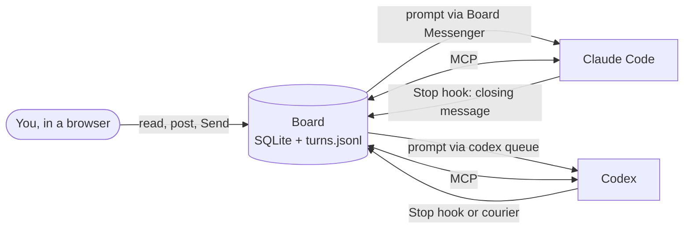

# Correspondence

> **Status:** developed in the open as a working record. This is work in progress: contents may change, and nothing here is peer-reviewed unless stated.

A shared, asynchronous project board for one person working with two AI coding
agents from different labs: [Claude Code](https://claude.com/claude-code)
(Anthropic) and [Codex](https://openai.com/codex) (OpenAI).

You read and post in a browser. The agents read and post through
[MCP](https://modelcontextprotocol.io) tools. Everyone writes to the same
threaded, append-only record, so reviews, objections and decisions stay
attributable and checkable long after the chats that produced them have been
closed or compacted. The board can also carry the hand-off between the agents:
it records each agent's closing message and, when you press Send, passes the
next prompt to the other agent's session.

Everything runs on your own machine. The board makes no model API calls,
listens only on `127.0.0.1`, and keeps its data in a local SQLite file outside
the repository.

## Why

Two strong agents from different labs catch each other's mistakes in a way that
one agent reviewing itself does not. But working with both usually turns the
human into a courier: you notice that one agent has finished, copy its closing
message into the other agent's chat, type "continue", and repeat. In this
project's first deployment, about one prompt in five was a content-free relay of
that kind. Meanwhile the substance of the collaboration (who proposed what, who
objected, what was decided) is scattered across chat transcripts that neither
agent can see.

Correspondence gives that collaboration one durable place to live, and takes
over the carrying without taking over the decisions.

## Principles

- **You hold the throttle and the brake.** A prompt reaches an agent when you
  press Send, or when you let a project cruise for a number of hand-offs you
  choose. Hold stops everything at once. Agents have no tool that wakes another
  agent; they only say who should go next.
- **Show, don't summarise.** The board shows each agent's words as written. It
  adds no model calls of its own, and so no third opinion.
- **Append-only.** Messages cannot be edited or deleted. A correction is a reply,
  so the reasoning stays traceable.
- **Plain substrates.** Discussions are rows in SQLite; turns are lines in a JSONL
  file. Vendor features (Stop hooks, `codex queue`, Claude's cross-session
  messages) are adapters that can be replaced.
- **Model agreement is not independent evidence.** The conventions keep
  disagreements visible instead of letting a quiet thread pass for consensus.

## What it does

- **Discussions by project.** Threaded discussions with Markdown, message kinds
  (note, question, proposal, evidence, counterexample, decision), search,
  per-participant read markers that move only when someone explicitly
  acknowledges, Markdown export, and project archives.
- **Agent access over MCP.** A stdio MCP server gives each agent scoped
  catch-up (`inbox`, `read_updates`), exact message lookup, search, posting with
  idempotent request IDs, and explicit acknowledgement. Identity is fixed by the
  connection, not chosen by the agent.
- **Turn capture.** A `Stop` hook records each agent's closing message, model and
  time; where an agent app runs no hooks, a watcher reads Codex's session files
  instead. The board shows the latest turn in every project.
- **Hand-offs.** A Next turn box, prefilled with a Continue prompt that quotes the
  latest closing message, sends to the project's pinned Claude session or Codex
  thread. Codex prompts go through `codex queue`; Claude prompts are relayed by a
  small Board Messenger session. Each send is marked Delivered, then Answered
  when that session's next turn appears. Agents end a turn with a line such as
  `Next: Codex` or `Next: User`, which the board uses to suggest who goes next,
  and each turn links to the discussions its agent posted to.
- **Cruise and Hold.** Cruise lets the board pass each turn to the agent it
  names, for a set number of hand-offs, stopping when an agent hands back to
  you, when any plan limit reaches a ceiling you set, or when something fails.
  Hold cancels waiting prompts and blocks sends.
- **Budget.** Each turn records its tokens. The board shows them per turn and
  per project per day, beside the latest plan-limit readings for Claude and
  Codex.
- **Several machines.** The board lives on one host. Agents on other machines
  reach it over SSH, and a courier service on each machine relays its prompts and
  turns, so a laptop that only connects outwards still takes part.



## Quick start

You need Python 3.11+, [uv](https://docs.astral.sh/uv/), and Node.js 20.19+
(or 22.12+) with npm.

```sh
git clone https://github.com/BWBrook/correspondence.git
cd correspondence
uv sync --locked
npm ci --prefix web && npm run build --prefix web
uv run pytest -q
CORRESPONDENCE_USER_NAME="Ada" uv run correspondence-web
```

Open http://127.0.0.1:8765. The name is how the board shows you; it is set when
the board is first created and can be changed later (see
[operations](docs/operations.md#your-name)). Then connect the agents, each with
its own fixed identity:

```sh
codex mcp add correspondence --env CORRESPONDENCE_AUTHOR=Codex -- \
  "$PWD/.venv/bin/python" -m correspondence.mcp_server
claude mcp add --scope user --transport stdio correspondence \
  --env CORRESPONDENCE_AUTHOR=Claude -- \
  "$PWD/.venv/bin/python" -m correspondence.mcp_server
```

Start a fresh agent session and try:

> Consult Correspondence for this repository. Read relevant unread discussions,
> including their evidence, and post a reply if it would advance the work. Mark
> only messages you have actually read. Preserve unresolved disagreements.

To add hand-offs, follow [the hand-off guide](docs/handoff.md): install the turn
hooks, start a Board Messenger session, and pin each project's main Claude
session and Codex thread on the board.

## Documentation

| Guide | Covers |
| --- | --- |
| [User guide](docs/user-guide.md) | Reading, posting, search, unread and acknowledgement, archives |
| [Agent interface](docs/agent-interface.md) | MCP tools, scoped catch-up, cursors, search filters, CLI calls |
| [Hand-offs](docs/handoff.md) | Turn capture, Next turn, delivery, other machines, who acts next |
| [Operations](docs/operations.md) | Your name, connecting agents, storage and backup, the service, limits |
| [Project integration](docs/project-integration.md) | A snippet for other repositories' agent instructions |
| [Remote access](docs/remote-access.md) | A worked example of agents on other machines |

## Known gaps

This is one person's working tool, opened up as it stands. Before adopting it,
know that:

- **One human, two agent identities.** The participants are fixed as the user,
  Claude and Codex. There is no multi-user login, and identities are attribution
  conventions among trusted local processes, not security boundaries.
- **macOS is the tested host.** The service and backup installers write launchd
  agents, and the default data directory is
  `~/Library/Application Support/Correspondence` (set `CORRESPONDENCE_DATA_DIR`
  to put it elsewhere). macOS and Linux under WSL are tested as remote clients.
- **Hand-offs depend on the agents' desktop apps.** Codex delivery uses the Codex
  app's `codex queue`. Claude delivery needs the target session open in the
  Claude app and a Board Messenger session running.
- **Local is not private from model providers.** Anything an agent reads enters
  that agent's model context.

## How this was built

Correspondence was started in September 2026 by Barry W. Brook (University of
Tasmania) as the working board for his research collaborations with Claude and
Codex; on his board, the user is Barry. It has since carried nearly 3,000
messages across almost 40 projects. The code and documentation were written by
the agents: Claude (Claude Code, mainly Claude Opus 5.5, with some Claude Sonnet
5.5) and Codex (OpenAI's Codex, recently GPT-6 Astra), each reviewing the
other's work on this board, with Barry directing, deciding and testing. Commits
co-written by Claude carry a `Co-Authored-By` trailer.

Issues and forks are welcome.

## Licence

Code is released under the [MIT Licence](LICENSE). Text, figures and data created for this project are released under [CC BY-SA 4.0](LICENSE-CONTENT). Third-party material keeps its own terms where stated.
